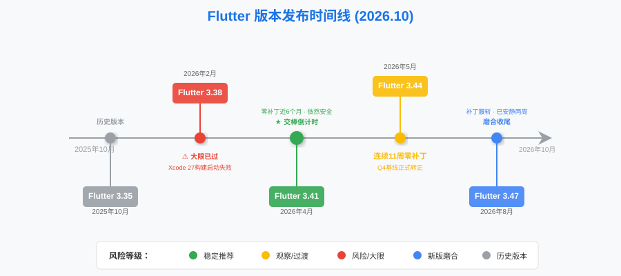
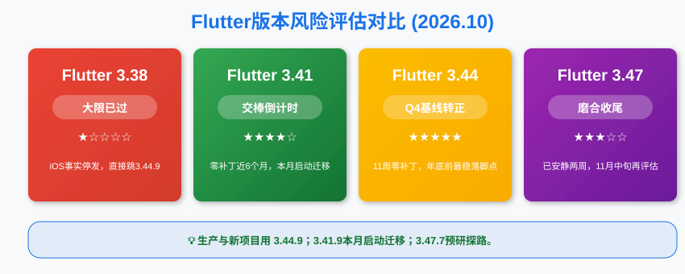
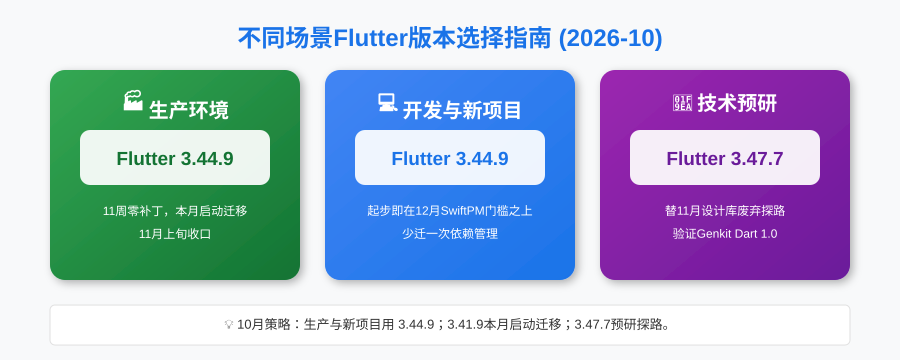

**大家好，我是老刘**

上个月问我"3.47什么时候能用"的那位兄弟，这个月可以开始掰手指头记日子了。10月9日的3.47.7之后，这个版本已经安安静静躺了两周，是它出生以来最长的一段沉默。

另一边，3.44.9的零补丁纪录走到了第11周，3.41.9逼近六个月。9月大限翻篇之后，整个10月的Flutter社区都在为年底最后两道坎蓄力。照例，先把10月的版本情况捋清楚，再说接下来该干什么。

***

## 一、10月Flutter大事件

### 3.47补丁密度腰斩，修复沉到了无障碍层

9月3.47一个月连发四个补丁，10月只发了两个，而且中间隔了一周。

- 10月2日的3.47.6只修了一个问题，Windows生产应用挂起。这个修复分量不轻，挂起是生产事故级别的问题，但它只影响Windows桌面端
- 10月9日的3.47.7修了两个iOS无障碍问题，OverlayPortal弹出层的无障碍框被像素比缩放、VoiceOver焦点对不上可见控件，以及ReorderableListView在VoiceOver下焦点跑到屏幕左上角

把这两个补丁和9月放在一起看，趋势很清楚。9月修的是`Actions.handler`返回null这种框架级bug，10月修的是VoiceOver用户才会撞上的边角场景。**问题从主干沉到了末梢，这是磨合进入收尾阶段的典型信号。**

截至今天，3.47.7之后已经安静了14天。老刘的标准没变，连续安静一个月以上才算数。照这个节奏，11月中旬见分晓。

### 3.44.9零补丁11周，正式转正

8月7日的3.44.9之后，这个版本再没有任何动静，安静期从9月的七周拉长到11周。

9月我把它放在"Q4基线候选"的位置上，说窗口翻倍再看。现在窗口翻了快两倍，三个条件全部满足。观察期足够长，12月SwiftPM的门槛就是它，3.47又没完全安静下来。**从本月起，3.44.9摘掉"候选"的帽子，正式成为Q4验证基线。**

9月定下的计划是"11月之前完成迁移"，换算成日历就是，这个月必须动手了。

### Genkit Dart 1.0发布，Flutter的AI故事换了主角

10月8日，官方发布了Genkit Dart 1.0稳定版，一个用Dart和Flutter构建AI驱动的应用和智能体工作流的开源框架。

10月20日的官方博客又在谈agentic development，核心观点是老刘很认同的一句话，AI时代开发的瓶颈不是代码生成，而是验证速度。

这两件事放在一起，Flutter生态的AI叙事正在从"AI帮你写Flutter代码"扩展到"用Flutter写AI应用"。前者是工具红利，后者是生态位。一个跨平台框架如果能在AI应用层卡住位置就比版本号重要得多。

***

## 二、Flutter最近5个版本深度解析（10月更新）

### 1. 版本列表

先看一张核心版本演进图。

| Flutter大版本 | 最近补丁发布日期 | Dart主版本 | 说明 |
| :--- | :--- | :--- | :--- |
| **3.47** | 2026年10月9日（3.47.7） | Dart 3.13.5 | 补丁腰斩，磨合进入收尾 |
| **3.44** | 2026年8月7日（3.44.9） | Dart 3.12.2 | 零补丁11周，**正式转正Q4基线** |
| **3.41** | 2026年5月1日（3.41.9） | Dart 3.11.5 | 零补丁近6个月，交棒倒计时 |
| **3.38** | 2026年2月12日（3.38.10） | Dart 3.10.9 | 大限已过，iOS侧事实停发 |
| **3.35** | 2025年10月23日（3.35.7） | Dart 3.9.2 | 彻底过时，到今天整一年 |

### 2. 核心版本分析

**Flutter 3.47.7 - 磨合收尾，离转正还差半个月的安静**

- **状态**
**非生产环境使用，测试环境预研。**

- **评价**
补丁密度从一月四个降到一月两个，修复内容从框架级沉到VoiceOver边角。8月的"能不能用"，9月的"顺不顺手"，到10月变成了"少数用户场景细不细"。一条完整的收敛曲线已经走出来了。

但老刘的标准不看曲线，看日历。3.47.7之后安静了14天，距离"连续安静一个月"还差半个月。11月中旬如果还保持沉默，3.47就可以进入生产评估流程。

- **策略**
预研团队跟进到3.47.7，重点验证两条链路。一是11月设计库废弃，`dart fix`迁移在自己代码上跑通没有；二是12月SwiftPM，依赖清单里的插件迁移率还剩几个硬骨头。生产团队继续等，再等半个月。

**Flutter 3.44.9 - 零补丁11周，正式转正**

- **状态**
**正式成为Q4验证基线，生产迁移的目标版本。**

- **评价**
三个月前它还是"风暴眼里的过渡版本"，8月我说"够格但不值得专门动一次"，9月我说"晋级候选"。11周的零补丁摆在这里，该给的观察期给足了，该等的证据等到了。

更关键的是时间账。12月SwiftPM强制的门槛是3.44，而3.47最早也要11月中旬才够格进评估。想在12月之前从容收口的团队，3.44.9是当下唯一验证充分的选择。

- **策略**
在3.44.9的团队安心住着，年内不用再动。在3.41.9的团队，本月就是执行月，以3.44.9为基线跑完整验证，11月上旬完成迁移，给12月留足余量。还在3.38的团队不用想了，直接跳3.44.9。

**Flutter 3.41.9 - 交棒倒计时**

- **状态**
**依然安全，但开始交棒。**

- **评价**
5月1日至今零补丁逼近六个月，9月大限平稳过关，这个版本已经把自己的历史任务完成得无可挑剔。它不需要被贬低，只是时钟走到了交接的位置。

- **策略**
还在3.41.9的生产团队不用慌，这个版本到12月之前依然完全合法。但合法不等于最优，12月之后它将低于SwiftPM门槛，与其年底踩点，不如本月从容迁完。

**Flutter 3.38.10 - 入土为安**

- **状态**
**iOS侧事实停发。**

- **评价**
连续追杀了半年，从9月起已经没有新话可讲。这个月只说一个数据，它的继任者们零补丁纪录分别是11周和6个月，足以说明离开它是对的。

***

## 三、10月版本选择建议

#### **生产环境（Stable Production）**

- **推荐**
**Flutter 3.44.9**

- **理由**
零补丁11周通过观察期，12月SwiftPM门槛的最低安全线，验证窗口刚好够用。还在3.41.9的团队本月启动迁移，11月上旬完成，这是年内最后一次、也是最从容的一次。不推荐等3.47，它最早11月中旬才够评估资格，等它就把12月的余量烧光了。

#### **开发环境与新项目（Development & New Project）**

- **推荐**
**Flutter 3.44.9**

- **理由**
新项目这个月直接站在3.44.9上起步，SwiftPM开箱即用，不用两个月后再迁一次依赖管理。3.47的无障碍补丁刚发，工具链还差最后一段安静期，让预研团队先蹚。

#### **技术预研（Tech Exploration）**

- **推荐**
**Flutter 3.47.7**

- **理由**
补丁腰斩、修复下沉，预研体验比9月又顺了一档。这个月预研有两件正经事，一是用`dart fix --apply --code=migrate_design_widgets`把设计库迁移完整跑一遍，替11月探路；二是验证Genkit Dart 1.0这类AI框架在3.47上的兼容性，明年的技术栈可能就长在这上面。

***

## 四、两个倒计时，一份作业

9月翻篇之后桌面上剩两个倒计时，这个月其中一份作业该交卷了。

### 1. 距离设计库废弃还有一个月

9月我说10月是动手的最佳窗口，在3.47预研分支上跑一遍`dart fix`，把阻塞项列出来。

现在窗口还剩最后一个月，该验收了。跑过迁移工具的团队，检查一下自己的代码是不是已经全部迁到独立的material和cupertino包，`MaterialUiCompatibilityBridge`兼容桥上还挂着多少依赖里的旧引用。**还没动手的团队，这是最后一段从容期，11月废弃落地之后，这件事就从"主动优化"变成"被动还债"。**

### 2. 距离SwiftPM强制迁移还有两个月

**最低要求**
Flutter 3.44

9月要求大家把依赖清单过一遍，这个月的要求升级一步。清单里没迁移的插件，能换的应该已经换完了，换不掉的，去issue区看一眼进展，官方数据里Top 100插件的迁移率已经超过九成，剩下的少数派要么在收尾，要么该考虑放弃了。

以3.44.9为基线的完整验证本月必须跑起来，11月上旬收口。这件能从容做完的事，别拖成12月的火烧眉毛。

### 3. AI工具链进入"验证速度"竞赛

Genkit Dart 1.0的发布和官方那篇"瓶颈在验证速度"的博客，指向同一个判断，AI帮你写代码已经不是新鲜事，AI帮你验证代码才是下一道分水岭。

Flutter的单一代码库多平台输出，天然缩短了验证链路，一套代码跑一次验证覆盖所有平台。老刘维持之前的判断，**能熟练使用AI工具的开发者，产出效率和不用AI的完全不是一个量级，而"验证"环节的差距，会比"生成"环节拉得更开。**

***

## 总结

10月的Flutter社区，关键词是收敛。3.47用减半的补丁和沉到无障碍层的修复，走完了磨合曲线的最后一段；3.44.9用11周的沉默换来了Q4基线的正式身份；3.41.9逼近六个月的零补丁纪录，开始体面交棒。

老刘建议：**生产环境以3.44.9为目标本月启动迁移，11月上旬收口；新项目直接站在3.44.9上起步；预研团队跟进3.47.7，替大家把11月设计库和12月SwiftPM的路蹚平，顺便看一眼Genkit Dart 1.0。**

9月的墙塌过了，11月和12月的两面墙就在眼前。这个月动手的人，年底可以喝着茶看别人救火。

> 🤝 如果看到这里的同学对客户端开发或者Flutter开发感兴趣，欢迎联系老刘，我们互相学习。
>
> 🎁 点击免费领老刘整理的《Flutter开发手册》，覆盖90%应用开发场景。
>
> 🚀 [覆盖90%开发场景的《Flutter开发手册》](https://mp.weixin.qq.com/s/6FeO9IoHbEuM-vhISitUxw)

> 📂 老刘也把自己历史文章整理在GitHub仓库里，方便大家查阅。
> 
> 🔗 <https://github.com/lzt-code/blog>
