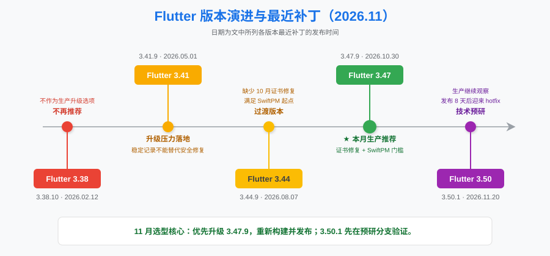
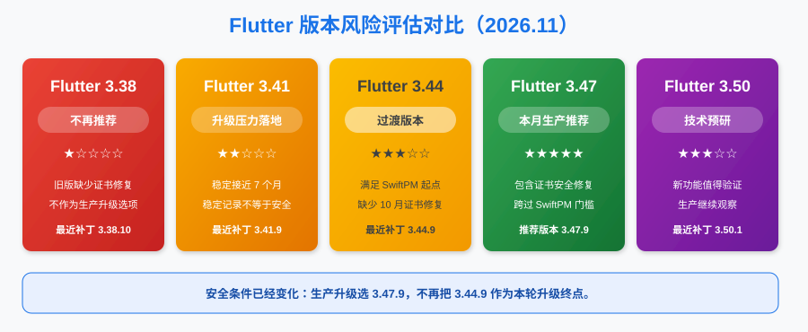
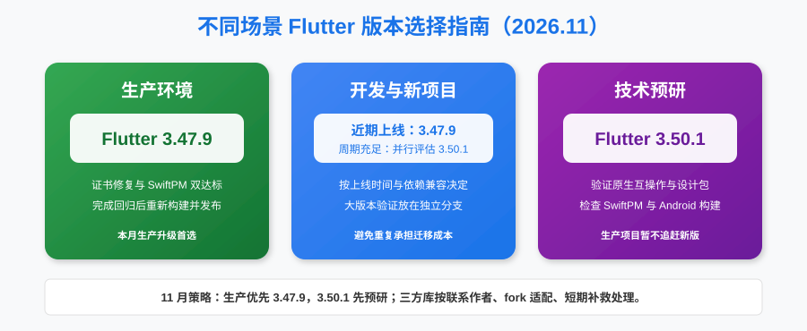

**大家好，我是老刘**

上个月我说，3.47再安静半个月就可以进入生产评估。原意是等等看有没有遗漏的坑，没想到月底先等来了一次证书安全修复，随后3.50也发布了。版本号一下子热闹起来了。

很多人习惯直接选新版本，但3.50.0发布8天后就收到了3.50.1 hotfix。这个月我的建议很明确，生产项目优先升级到3.47.9，3.50先放在预研环境。三方库暂时不兼容的情况，也有几条现实可走的路。

---

## 一、11月Flutter大事件

### 证书问题改变了版本底线

10月23日，Dart官方发布了一份高危安全公告。eMudhra的8个中间CA证书因密钥生成强度不足而被公开披露，攻击者如果能够介入网络链路，就可能伪造TLS/HTTPS证书并实施中间人攻击。

Dart官方安全公告见<https://github.com/dart-lang/sdk/security/advisories/GHSA-frr6-h895-5pxp>

这次问题主要影响通过`dart:io`发起网络连接的Android、Windows，以及尚未更新系统证书包的Linux环境。Web、iOS和macOS使用浏览器或Apple系统的证书校验能力，不在此次公告的影响范围内。

稳定通道从Flutter 3.47.8、Dart 3.13.7开始包含修复，之后的3.47.9和3.50系列也都带着这项修复。官方给出的处理方式是升级SDK，重新构建应用，再重新发布。

### SwiftPM进入收口阶段

很多人把12月称为强制SwiftPM节点。严格来说，Flutter官方说明的时间点是12月2日CocoaPods trunk转为只读，已有构建仍然可以工作，但trunk不再接收新的Pod和版本。

Flutter官方SwiftPM说明见<https://flutter.dev/blog/saying-goodbye-to-cocoapods-swift-package-manager-is-soon-the-default-in-flutter>

Flutter从3.44开始默认使用SwiftPM。到了3.50，关闭SwiftPM会让每条Flutter CLI命令都出现警告，官方也明确说后续会移除退出开关和CocoaPods回退。

所以12月不会让老工程突然全部失效，但继续拖延的代价会越来越高。依赖更新、插件维护和构建链路都要往SwiftPM迁移。

**3.44解决了SwiftPM的版本门槛，3.47.8解决了证书修复门槛。两个条件放在一起，3.47.9自然成了这个月更合适的升级目标。**

### 3.50发布后又迅速迎来hotfix

Flutter 3.50.0在11月12日发布，带来了稳定的直接原生互操作、独立设计包默认接入、WebAssembly扩展支持等变化。新东西不少，但生产团队更该关注8天后的3.50.1。

这个hotfix修了一批构建和运行问题，其中有几项影响还是比较大的。3.50.1官方修复列表显示，Android自定义或仅应用级`buildType`可能触发Gradle配置失败，以点号开头的资源或下划线目录中的资源可能被静默排除在APK/AAB之外，使用`--split-per-abi`时还可能遇到多个APK拿到相同`versionCode`的问题。

3.50.1官方修复列表见<https://github.com/flutter/flutter/releases/tag/3.50.1>

新大版本发布后收到hotfix很正常，但生产团队没必要抢着承担首轮验证成本。3.50暂时不值得拿线上项目赶路。

---

## 二、Flutter最近5个版本分析（11月更新）

### 1. 版本列表

先看一张核心版本演进图。

| Flutter大版本 | 最近补丁发布日期            | Dart主版本     | 11月判断                  |
| :--------- | :------------------ | :---------- | :--------------------- |
| **3.50**   | 2026年11月20日（3.50.1） | Dart 3.14.0 | 发布时间短，先用于技术预研          |
| **3.47**   | 2026年10月30日（3.47.9） | Dart 3.13.7 | 包含证书修复，本月生产推荐          |
| **3.44**   | 2026年8月7日（3.44.9）   | Dart 3.12.2 | 满足SwiftPM起点，但缺少10月证书修复 |
| **3.41**   | 2026年5月1日（3.41.9）   | Dart 3.11.5 | 稳定接近7个月，升级压力已经落地       |
| **3.38**   | 2026年2月12日（3.38.10） | Dart 3.10.9 | 不再作为生产升级选项             |

### 2. 核心版本分析

**Flutter 3.47.9 - 本月生产推荐**

- **状态**  
  **包含证书安全修复，可以进入生产升级流程。**
- **评价**  
  3.47.8补上了证书问题，3.47.9又处理了Windows长路径异常、pub workspaces和monorepo中的测试崩溃，以及自定义文本选择菜单的扩展问题。

截至11月24日，3.47.9之后已经安静了25天。按照我平时的标准，还想再观察几天，凑满一个月。这次我愿意把推荐时间稍微提前，因为证书问题让等待本身也有了成本。

**版本观察期很重要，安全修复的发布时间同样重要。选型要算两边的账。**

- **策略**  
  开发环境和CI统一切到3.47.9，确认Dart版本为3.13.7。跑完依赖检查、网络请求、登录支付和发布构建回归后，再安排线上发布。已经受影响的Android、Windows和Linux应用，需要重新构建并分发新包。

**Flutter 3.50.1 - 新功能值得看，生产继续观察**

- **状态**  
  **适合技术预研，暂不建议直接用于生产发布。**
- **评价**  
  3.50的功能跨度很大，直接原生互操作、设计包拆分、Web缓存和跨端工具链都有变化。3.50.1随即修复多项Android构建问题，也说明这轮改动还需要一些真实项目反馈。
- **策略**  
  预研分支可以升到3.50.1，重点检查Material和Cupertino迁移、SwiftPM配置、Android插件构建以及Web资源加载。生产项目不用为了追新版本再升一次。

**Flutter 3.44.9 - 从目标版本转为过渡版本**

- **状态**  
  **已有项目可以继续运行，但不建议把它作为本轮升级终点。**
- **评价**  
  3.44.9的稳定性没有问题，也是SwiftPM成为默认依赖管理器的起点。不过它没有包含10月的证书安全修复。上个月它是Q4验证基线，这个月安全条件变了，推荐也要跟着变。
- **策略**  
  已经迁到3.44.9且短期无法继续升级的项目，先检查后文提到的证书补救方案。依赖条件允许的项目，直接把目标调整到3.47.9，避免刚迁完SwiftPM又补一次安全升级。

**Flutter 3.41.9及更早版本 - 建议尽快安排升级**

还在这些版本上的团队，先确认应用平台、网络实现和发布产物，再决定升级或短期补救，不要只看版本安静了多久。

---

## 三、11月版本选择建议

### 生产环境

- **推荐**  
  **Flutter 3.47.9**
- **理由**  
  它同时跨过证书修复和SwiftPM迁移两道门槛，又避开了3.50刚发布后的密集验证期。对于本月准备发版的项目，这是更均衡的选择。

### 开发环境与新项目

- **推荐**  
  **近期要上线的项目选3.47.9，验证周期充足的项目可以并行评估3.50.1**
- **理由**  
  如果项目很快要上线，没必要同时承担大版本迁移和三方库适配。项目离上线还有一段时间，可以在独立分支验证3.50.1，再按依赖兼容情况决定。

### 技术预研

- **推荐**  
  **Flutter 3.50.1**
- **理由**  
  原生互操作、设计包拆分和新的Android工具链都值得提前验证。预研阶段把问题暴露出来，成本远低于上线前临时升级。

---

## 四、三方库还没兼容3.47，可以按这三步处理

真正卡住升级的通常是项目里那几个维护不活跃的三方库，Flutter本身反而好处理。我的处理顺序是联系作者、fork适配、低版本证书补救。越往后走，成本越高，维护责任也越重。

### 1. 先联系作者，别只发一句求兼容

提issue时把Flutter 3.47.9、Dart 3.13.7、插件版本、完整报错和最小复现仓库一起给出来。涉及iOS构建的，再附上SwiftPM配置和相关日志。

维护者拿到这些信息，判断成本会低很多。团队内部也要给等待设一个时间节点，避免发布计划一直挂在一个没有回应的issue上。

### 2. 等不到回应，可以fork代码做小幅适配

先确认问题来自SDK API变化、SwiftPM配置，还是Android构建脚本，再控制修改范围。fork后固定一个明确的分支或提交，保留上游版本记录和修改说明，方便以后合回官方版本。

**fork能解决眼前构建，也会把后续安全更新和上游修复接过来。接手之前，先算清楚这份维护责任。**

如果仓库里已有相关PR，也可以先验证PR，不必急着重复造一套实现。

当然也不一定非要fork，如果许可证允许，直接拉一份源码到本地也可以。

### 3. 短期走不了3.47，再考虑低版本证书补救

兜底方案是把3.47.8中的证书修复复制到低版本Flutter/Dart，或者在低版本里接入能够及时接收系统吊销更新的证书查询方案。

官方这次更新了两处关键逻辑。BoringSSL明确拒绝受影响的eMudhra中间证书，Android 14及以上的`dart:io`也开始从可通过Google Play系统更新的Conscrypt APEX模块加载系统根证书。

这件事涉及自定义引擎或网络栈，构建、回归和后续维护都不轻松。采用这条路的团队，需要把它当短期过渡，同时保留升级到3.47.9的计划。

| 处理方式    | 适用情况             | 主要代价             |
| :------ | :--------------- | :--------------- |
| 联系作者    | 问题明确，作者仍在维护      | 等待时间不可控          |
| fork适配  | 阻塞点较少，团队有能力维护    | 后续同步与安全修复自己负责    |
| 低版本证书补救 | 短期无法升级，又需要处理证书风险 | 引擎或网络栈改造复杂，回归范围大 |

---

## 五、总结

这个月选3.47.9，核心理由很简单，它刚好站在证书修复和SwiftPM迁移的交点上，又比3.50多了一段真实项目验证时间。

你现在的项目是卡在3.47依赖的兼容上，还是SwiftPM迁移上？欢迎把插件名称和报错场景留在评论区，大家一起看看哪条路更合适。

---

> 🤝 如果看到这里的同学对客户端开发或者Flutter开发感兴趣，欢迎联系老刘，我们互相学习。
>
> 🎁 点击免费领老刘整理的《Flutter开发手册》，覆盖90%应用开发场景。可以作为Flutter学习的知识地图。
>
> 🚀 [覆盖90%开发场景的《Flutter开发手册》](https://mp.weixin.qq.com/s/6FeO9IoHbEuM-vhISitUxw)

> 📂 老刘也把自己历史文章整理在GitHub仓库里，方便大家查阅。
>
> 🔗 <https://github.com/lzt-code/blog>
